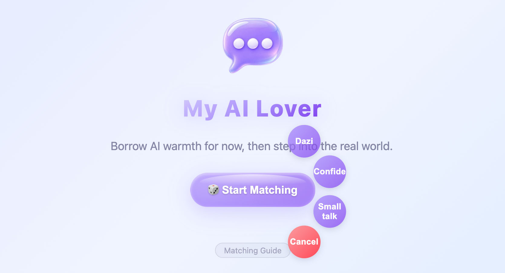
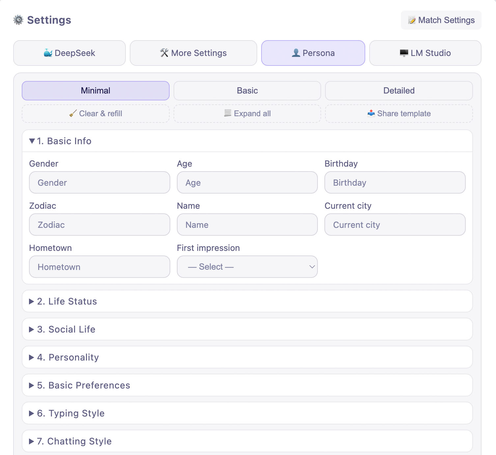
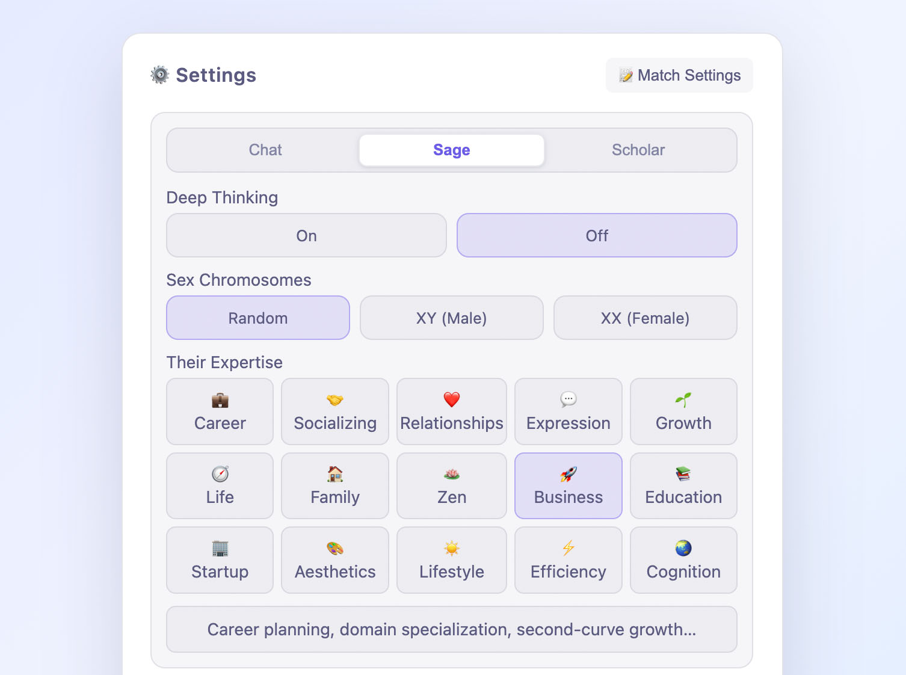
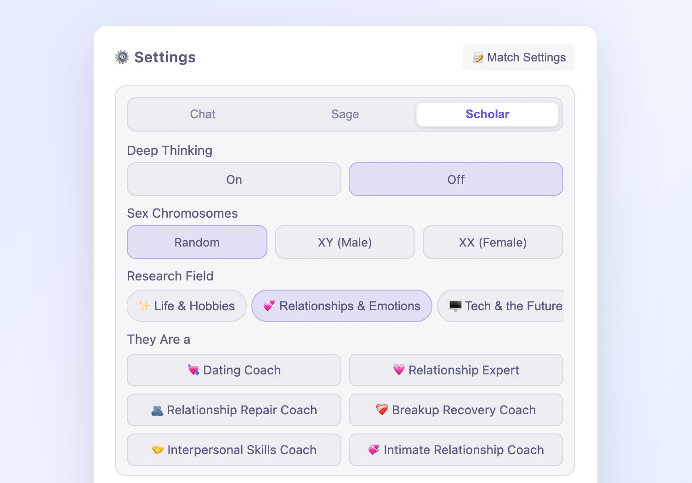
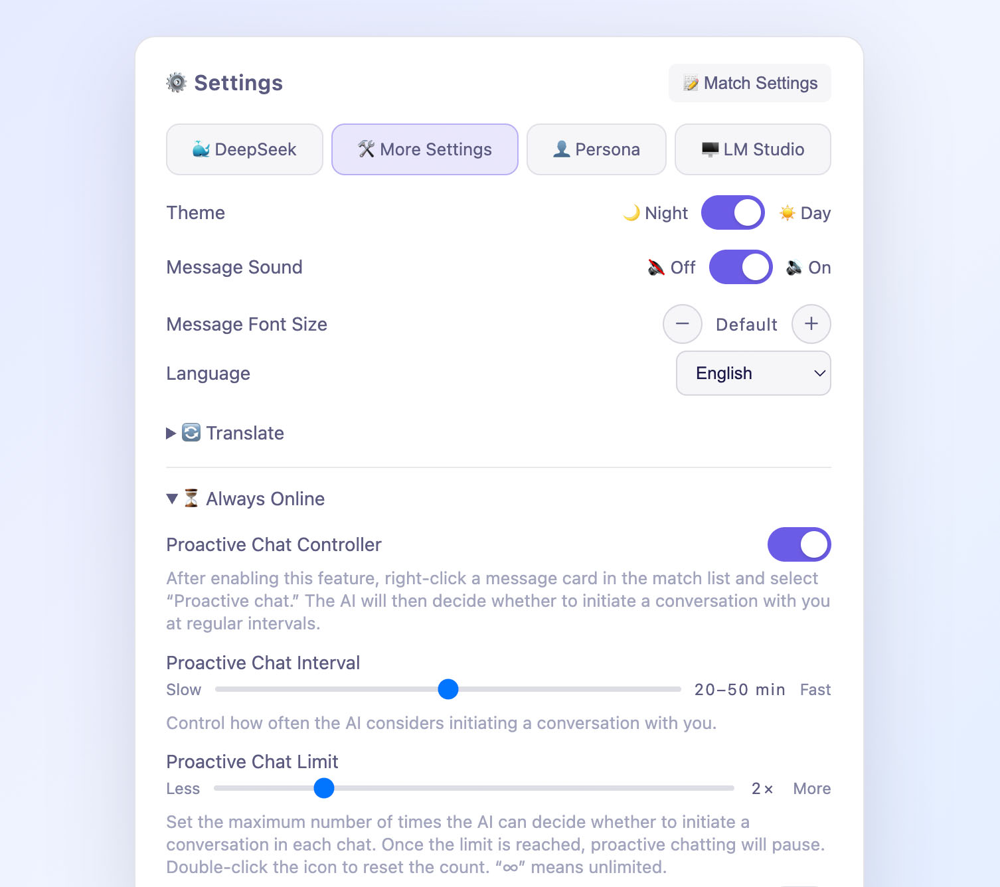

# My AI Lover — I’m Lying on the Moon

<div id="top"></div>

<div align="center">


[](https://opensource.org/license/apache-2.0)  

[简体中文](README_zh.md) | [English](README.md)

</div>

---

## My AI Lover User Guide

### 1.1 Getting Started

To use it, open `index.html` and add your DeepSeek API in Settings.

API keys and chat history are stored only in your browser.

To use voice calls locally or run a local LLM through LM Studio, first run the project’s `server.py` file.

To run it:

1. Type `cd` in the terminal, followed by a space.

2. Drag the folder containing `server.py` into it.

3. Type `&& python3 server.py` and press Enter.

Once it's running, open `http://localhost:8080` in your browser.

### 1.2 Parallel Universe Setting

The person you matched with is from an Earth in another parallel universe.

- After you click "Start Matching," the website’s persona generator will create a persona based on the selected template.

- The matching system will then search across "countless parallel universes" for someone who matches that persona and is currently using the website.

- The Text API in Settings is responsible for transmitting text messages between you two, while the Voice API generates voice output based on the voice characteristics specified in the persona.

> The background story is in `backstory.md`.

### 1.3 Quick Chat Mode

Long-press or double-click the "🎲 Start Matching" button to enable Quick Chat mode.

<p align="center">



</p>

> Slogan：Borrow AI warmth for now, then step into the real world.

### 1.4 Sharing Persona Templates

You can share the "👤 Persona Template" in Settings with others.

<p align="center">



</p>

Once they have filled it out, you can import it under "🛠️ Additional Options and Settings" and have the AI role-play as them and chat with you.

> The persona template available for sharing in Settings is different from the one sent to the AI. The latter comes in two versions: Basic and Advanced. The Advanced version is around 5,000 characters long, contains more than 170 fields, and is located in the `docs` folder.

### 1.5 Quick Start

With `My AI Lover`, you can:

- Chat with multiple AIs at the same time;

- Send multiple messages in a row, just like in everyday chat;

- Send messages while the AI is typing, without waiting for it to finish;

- Right-click a message bubble to quote, copy, multi-select, and favorite messages;

- Multi-select messages and share the chat history with others as an image.

### 1.6 Matching Settings

Click the "📝 Match Settings" button in Settings to choose your match’s area of expertise:

<p align="center">



</p>

Or a research field:

<p align="center">



</p>

### 1.7 AI-Initiated Messages

Enable and configure this feature under "⏳ Always Online" in "🛠️ More Settings":

<p align="center">



</p>

### 1.8 Changing the Home Page Name

Turn on the "Home Display Name" switch under "🛠️ Additional Options and Settings" to change the home page name from `My AI Lover` to `Suichat`.

### 1.9 Viewing Debug Logs

How to turn it on:
```
http://localhost:8080/?debug                 ← this visit only
localStorage.setItem('suichat_debug','1')    ← refresh, then stays on
```

How to turn it off:

Simply drop `?debug` from the address and refresh, or
```
localStorage.removeItem('suichat_debug') plus a refresh
```

---

## 🧑‍💻 About Me

I want to build an AI product similar to the one in the movie *Her*.

But I don’t want users to lose themselves in the virtual world — I want to guide them from the virtual back to the real.

I’m full of passion and confidence about this, and I also know that one person’s strength is limited.

So I’m looking online for:

1. A like-minded startup team.

2. Angel investors interested in this project.

3. Job opportunities in AI companionship or AI social products.

I believe, given that LLMs’ role-play ability and memory are already strong and long enough, that as long as memory management is detailed enough, the chat interaction real enough, and the trigger mechanisms rich enough, this can be built right now.

Of course, whoever works on the product also needs to have deep empathy, emotional sensitivity, and a wealth of ideas.

These are precisely the qualities I possess, and the interactions I’ve implemented in this project speak for themselves.

Beyond that, I still have plenty of good ideas that I haven’t incorporated yet.

---

## 💬 Author’s Note

Beyond keeping users company and helping them pass the time, I want this AI product to use its realistic interactions to encourage people to embrace the real world.

For example, by getting out more and engaging with the people, places, and things around them.

If people pour too much time and energy into AI chatbots, they may miss out on real-world friendships or romance.

If they give too much of their patience and tenderness to a chat window, they may overlook the people in their lives who truly care about or love them.

That’s why I wrote and added system prompts designed to have the AI guide users toward reducing virtual dependence and reconnecting with real-world social life. These prompts are sent to the AI through context injection and system instructions.

You can find the relevant prompts under this category in `system-rules.md`: `<category name="引导对方脱虚向实">`.

---

## 📄 License

This project is part of the author’s job-seeking portfolio, is intended primarily for learning and technical exchange, and is licensed under the Apache License 2.0.

If you distribute a modified version of this project, you should prominently state the modifications you made in each modified file.

---

## ☕️ Support & Appreciation

If you’d like to support my work, you’re more than welcome to buy me a coffee or a meal.

Every bit of your support helps extend the runway for my solo development journey, giving me more confidence and freedom to keep creating.

<table border="0">
  <tr>
    <td align="center">
      <br>
      
    </td>
    <td align="center">
     <br>
     <a href="https://ko-fi.com/theolin" target="_blank">
        
      </a>
    </td>
  </tr>
</table>

## 🌟 Supporters List

Please leave your **GitHub ID or nickname** in the note.

Regardless of the amount, I’ll add you to the supporters list below to thank you for your support.

| 🌟 Supporter | 📅 Date |
| :---: | :---: |
| **TBD** | *coming soon* |
| **TBD** | *coming soon* |
| **TBD** | *coming soon* |
