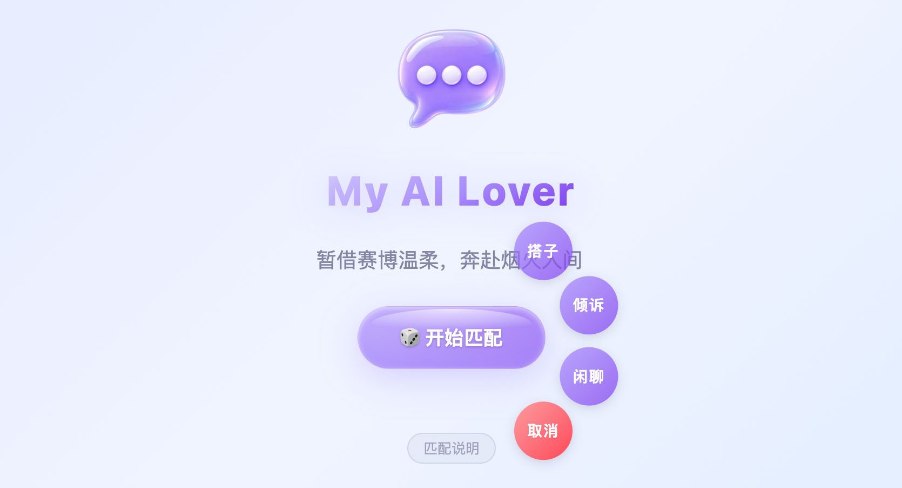
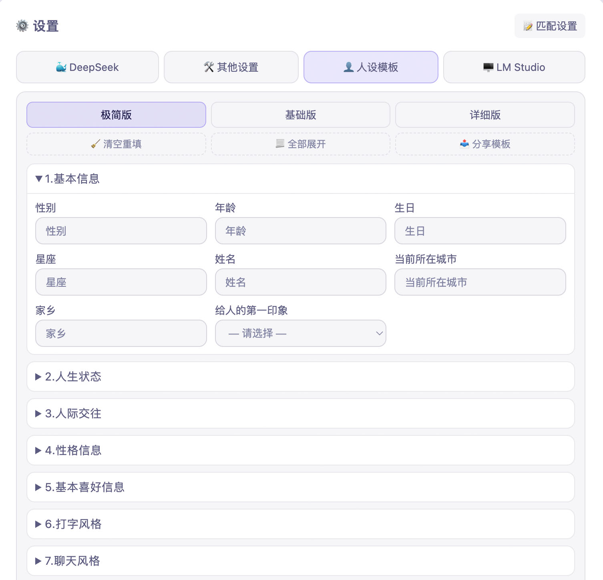
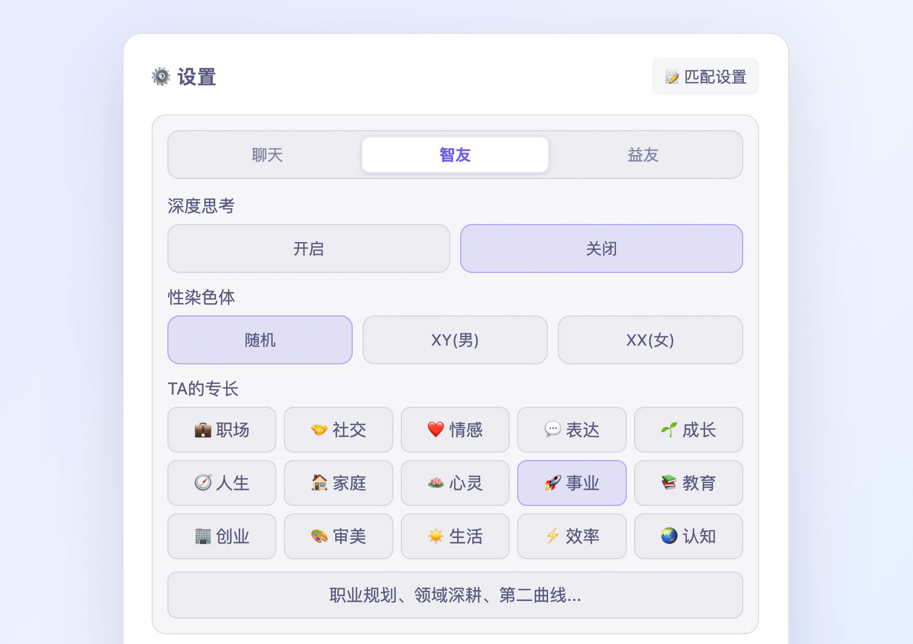
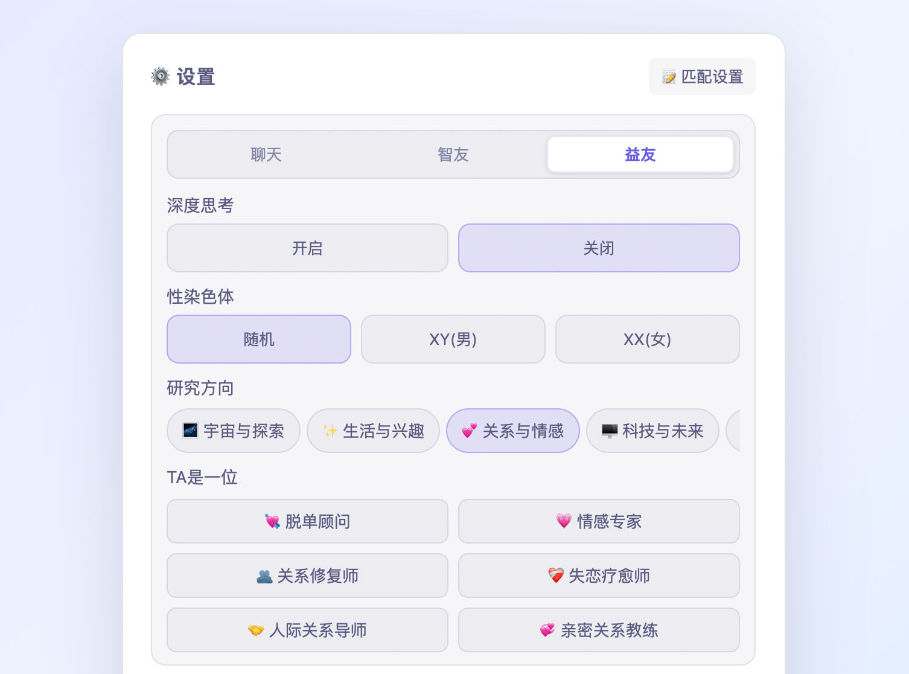
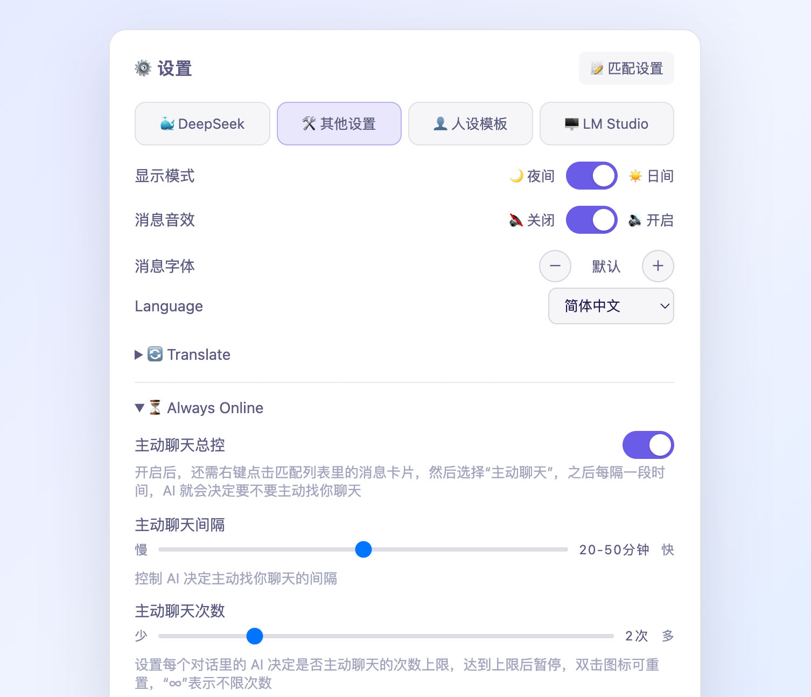

# My AI Lover — I’m Lying on the Moon

<div id="top"></div>

<div align="center">


[](https://opensource.org/license/apache-2.0)  

[简体中文](README_zh.md) | [English](README.md)

</div>

---

## My AI Lover 使用指南

### 1.1 开始使用

打开 `index.html` 文件，在设置里接入 DeepSeek 的 API 即可使用。

API 信息和聊天记录只保存在你自己的浏览器里。

在本地使用语音通话功能或通过 LM Studio 使用本地大模型时，请先运行项目里的 `server.py` 文件。

运行方法如下：

1. 先在终端里输入`cd`并按一下空格。

2. 然后把 `server.py` 所在的文件夹拖拽到里面。

3. 之后输入`&& python3 server.py`并按回车。

完成后在浏览器访问`http://localhost:8080`。

### 1.2 平行时空的设定

你匹配到的人来自另一个平行时空的地球。

- 点击「开始匹配」后，网站的人设生成器会根据模板生成人设。

- 之后网站的匹配系统会在「无数个平行时空里」寻找符合该人设且正在使用这个网站的人。

- 设置里的文本 API 负责传输你们之间的文字消息，语音 API 负责根据人设里的声音特征输出声音。

> 背景故事在 `backstory.md` 里。

### 1.3 快捷聊天模式

长按或双击主页的“🎲 开始匹配”按钮，可开启快捷聊天模式：

<p align="center">



</p>

> Slogan：暂借赛博温柔，奔赴烟火人间。

### 1.4 分享人设模板

你可以把设置里的“👤 人设模板”分享给其他人：

<p align="center">



</p>

对方填写后，在“🛠️ 其他选项和设置”里导入，就能让 AI 扮演 TA 和你聊天了。

> 设置里用于分享的人设模板和发给 AI 的有区别，后者分为基础和进阶两个版本，进阶版约 5000 字，包含 170 多个字段，在 `docs` 文件夹里。

### 1.5 快速上手

你可以通过 `My AI Lover`：

- 同时和多个 AI 聊天；

- 像日常聊天一样，连续发送多条消息；

- 在 AI 打字的时候发消息，不用等 AI 把话说完；

- 右键点击消息气泡，引用、复制、多选和收藏消息；

- 多选消息，然后将聊天记录以图片的形式分享给其他人。

### 1.6 匹配设置

点击设置里的“📝 匹配设置”按钮可选择匹配对象的专长：

<p align="center">



</p>

或研究方向：

<p align="center">  



</p>

### 1.7 让 AI 主动给你发消息

在“🛠️ 其他设置”里的“⏳ Always Online”中开启：

<p align="center">



</p>

### 1.8 更改主页名称

开启“🛠️ 其他选项和设置”里的“主页显示名称”开关，可将主页名称从 `My AI Lover` 改为 `Suichat`。

### 1.9 查看调试日志

开启方法：
```
http://localhost:8080/?debug                 ← 只这次有效
localStorage.setItem('suichat_debug','1')    ← 之后刷新，长期有效
```

关闭方法：

```
localStorage.removeItem('suichat_debug') + 刷新
或者去掉地址里的 "?debug" 再刷新
```

---

## 🧑‍💻 关于作者

我想做出类似电影《Her》里的人工智能产品。

但不让使用的人沉迷虚拟，而是引导 TA “脱虚向实”。

我对此充满热情和信心，我也知道一个人的力量是有限的。

因此我想在线寻找：

1. 想法合拍的创业团队。

2. 对这个项目感兴趣的天使投资人。

3. AI 陪伴或 AI 社交方向的工作机会。

我认为在大模型的角色扮演能力和记忆已经足够强、足够长的前提下，只要记忆管理足够细致，聊天交互足够真实，触发机制足够丰富，那么现在就可以做出来。

当然，还需要做产品的人有足够强的同理心、足够细腻的情感和足够多的 ideas。

这些特质正是我所具备的，我在这个项目里实现的以下交互效果就是最好的验证。

除此之外，我还有很多好的想法没有加到项目里。

---

## 🔍 该项目实现的交互效果

<details>

<summary>语音通话方面的交互</summary>

1. **AI主动来电**：聊天时 AI 会主动给你打电话，你可以选择接听或拒绝。

2. **AI主动讲话**：电话接通后，AI 会结合当前时间和上下文主动讲话。

3. **AI主动挂断**：AI 会主动挂断电话，实现方法：关键词检测。

4. **AI接听决策**：你发起语音通话后，AI 会结合当前时间、上下文和你们之间的关系决定接或不接。

5. **AI主动回电**：如果你在 AI 做决定前取消了通话，AI 可能会回打给你。

6. **AI打破沉默**：如果超过 12 秒没人说话，AI 会主动找话题打破沉默。

7. **音色切换**：电话接通前会根据 AI 人设里的性别选择男声或女声。

8. **声音模仿**：电话接通前会提取 AI 人设里的声音特征，让语音模型模仿。

9. **通话转写**：可一键查看每通电话的文字记录。

10. **通话录音**：通话结束后会出现一个“通话记录”气泡，可以播放和暂停。

</details>

<details>

<summary>AI侧的交互</summary>

11. **消息逐条显示**：AI 的消息会逐条显示，实现方法：提示词规则 + 前端代码解析。

12. **模拟反应时间**：模拟真人收到消息后的反应时间，实现方法：延迟输出 AI 生成的消息，可在设置里调整。

13. **模拟正在输入**：模拟对方正在输入中的状态，实现方法：正在输入指示器 + 根据每条消息的字数计算持续时间。

14. **AI主动打招呼**：匹配成功后 AI 可能会主动打招呼，也可能会不说话，实现方法：提示词规则 + 前端代码解析。

15. **AI主动发消息**：在设置面板的“Always Online”里开启，实现方法：计时器 + 上下文注入。

> AI 每隔一段时间就会决定要不要主动找你聊天，稳定实现这个交互效果需借助项目里的 `server.py` 文件。

16. **AI主动加好友**：实现方法：提示词规则 + 关键词检测 + 上下文注入，检测到 AI 输出关键词后，会进行上下文注入，让 AI 结合最近的聊天内容撰写好友申请语。

17. **AI处理好友申请**：你发送好友申请后，AI 会结合你们最近的聊天内容决定要不要通过。

</details>

<details>

<summary>用户侧的交互</summary>

18. **连续发送**：你可以连续发送多条消息，AI 不会立刻回复。实现方法：输入事件监听 + 防抖，停止输入 4～9 秒后，才会调用 API 让 AI 回复。

19. **随时插话**：你可以在 AI 打字的过程中发消息，不必等 AI 把话说完。

20. **及时响应**：你发送新消息后，只要 AI 的待显示消息超过 1 条，系统就会重新调用 API，让 AI 回复你最新发送的消息。

21. **已读回执**：消息发送 3～5 秒后，消息气泡左侧会显示“已读”，如果是在逐条显示 AI 消息的期间发送，时间会缩短为 0.8 秒。

22. **引用消息**：右键点击消息气泡可以引用 AI 或自己的消息，可引用单条或多条，实现方法：上下文注入，告知 AI 引用消息和用户回复的区别。

23. **添加好友**：每个聊天窗口里的 AI 都有一个 ID（在好友资料面板），删除好友后可以通过搜索 ID 的方式加回来。

24. **多聊天窗口**：你可以同时和多个 AI 聊天，切换聊天窗口后，如果之前聊的 AI 发来了消息，会有未读消息提醒。

</details>

<details>

<summary>人设模板和系统指令</summary>

25. **千AI千面**：我编写了约 5000 字的人设模板，包含性别、年龄、性格特点等 170 多个字段。

26. **知识范围**：我在人设模板里加入了“知识范围”字段，并编写了知识范围驱动类的规则，让 AI 在聊天的时候有所不知。

27. **迎合与顺从倾向**：我编写了让 AI 根据和用户之间的关系、人设里的迎合、顺从倾向等因素，决定是否要答应用户要求的系统指令，避免过度迎合与顺从。

28. **引导用户从虚拟回归现实**：我还编写了一系列让 AI 引导用户减少虚拟依赖、回归现实社交的规则：每聊满 200 条消息，就在上下文中注入相关提示词；一旦触发系统提示词里的条件，AI 就会进行相应的引导，并分享人际交往、亲密关系处理等方面的经验和方法。

</details>

<details>

<summary>与现实世界建立连接</summary>

29. **构建世界观**：在系统提示词里告诉 AI “你匹配到的人来自另一个平行时空的地球”，同时加入规则“不要聊和见面有关的话题”。

30. **告知当前时间**：构建上下文的时候会告知 AI 当前的时间，包括年月日。

31. **告知天气状况**：实现方法：根据 AI 人设里的“当前所在城市”调用 API 查询天气信息。

32. **模拟日常作息**：回复速度设置为“正常”后，会根据 AI 人设里的日常作息调整 AI 的反应时间和打字速度。

33. **告知时间流逝**：实现方法：交互间隔超过 30 分钟时在上下文里注入“距你们上次聊天已经过了……”的提醒。

34. **生成好友地图**：和 AI 成为好友后，AI 所在城市的位置会显示在地图上。

</details>

<details>

<summary>记忆的生成和管理</summary>

35. **构建海马体**：人设生成后 AI 会记录记忆，交互间隔超过 9 h 时，AI 在回复前会记录新的记忆，AI 的记忆会被放进系统提示词的`<hippocampus>`（海马体）标签里。

36. **记忆模板化**：AI 会按模板记下：时间流逝期间做过的事情、线上线下的社交活动，未来 24 小时的计划，此时此刻的位置等。

37. **生成元认知**：模板内容还包括让 AI 根据聊天记录、人设信息和系统规则生成以下自我反思：是否偏离了人设，是否遵守了系统规则。

</details>

---

## 💬 作者的话

我除了想让这个 AI 产品能陪用户聊天解闷之外，还想用它真实的交互体验引导用户拥抱现实。

比如多出去走走、多去了解现实世界里的人事物。

如果把太多时间和精力花费在 AI 聊天机器人身上，可能会错过现实世界里的友情或爱情。

如果把太多耐心和温柔交付给 AI 工具的聊天窗口，可能会忽视身边真正在乎或爱你的人。

因此，我编写和加入了让 AI 引导用户减少虚拟依赖、回归现实社交的系统提示词，通过上下文注入和系统指令的方式发给 AI。

相关提示词在 `system-rules.md` 文件的这个分类里：`<category name="引导对方脱虚向实">`。

---

## 📄 开源协议

本项目是作者求职作品集的一部分，主要用于学习与技术交流，并按 Apache License 2.0 授权。

如修改后分发本项目，应在每一份修改过的文件中显著声明你所作的修改。

---

## ☕️ 支持与赞赏

如果你愿意成为我的“天使投资人”，欢迎请我喝杯咖啡或者请我吃顿晚餐。

你的每一份支持都是在帮我延长这条独立开发的生命线，让我更有底气，也能更自由地继续创作下去。

<table border="0">
  <tr>
    <td align="center">
      <br>
      
    </td>
    <td align="center">
     <br>
     <a href="https://ko-fi.com/theolin" target="_blank">
        
      </a>
    </td>
  </tr>
</table>

## 🌟 赞赏者名单

请在备注中留下你的 **GitHub ID 或昵称**。

无论金额多少，我都会将你列入下方的赞赏者名单，以感谢你的支持。

| 🌟 赞赏者 | 📅 日期 |
| :---: | :---: |
| **虚位以待** | *coming soon* |
| **虚位以待** | *coming soon* |
| **虚位以待** | *coming soon* |
